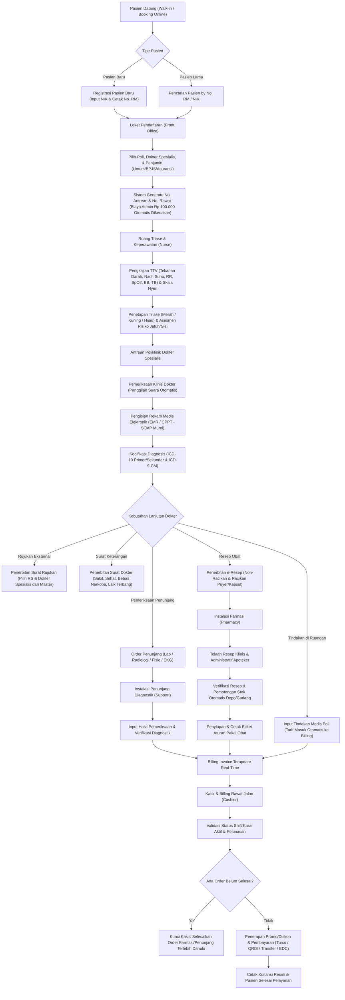
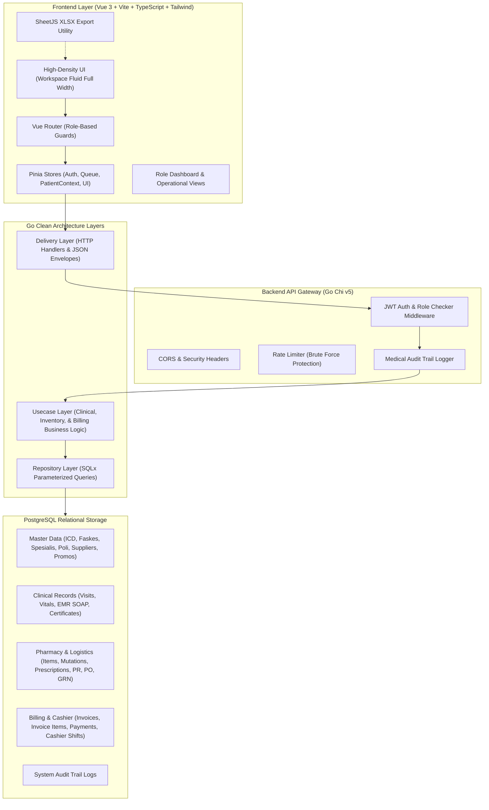

# Arsitektur Sistem, Alur Proses Bisnis & Katalog Fitur SIMRS-ASOY (E-Clinic)

Dokumen ini menyajikan pemetaan komprehensif seluruh proses bisnis (*end-to-end business flow*), matriks peran (*RBAC*), arsitektur teknis, dan katalog fitur yang telah diimplementasikan pada sistem **SIMRS-ASOY**.

---

## 1. DIAGRAM ALUR PROSES BISNIS KLINIS (END-TO-END PATIENT FLOW)

Alur pelayanan pasien berjalan secara otomatis, berjenjang, dan *real-time* lintas 9 peran (*roles*):

---

## 2. ARSITEKTUR TEKNIS SISTEM (SYSTEM ARCHITECTURE)

Sistem mengadopsi prinsip *Clean Layered Architecture* di Backend dan *Component-Driven State Architecture* di Frontend:

---

## 3. MATRIKS PERAN & HAK AKSES (ROLE-BASED ACCESS CONTROL - RBAC)

Sistem SIMRS-ASOY memiliki **9 Peran (Roles)** spesifik dengan hak akses fungsional yang terisolasi aman:

| No | Peran (*Role*) | Ruang Lingkup Otoritas & Tanggung Jawab Klinis | Welcome Page Dashboard & Indikator Kinerja |
| :---: | :--- | :--- | :--- |
| **1** | `SUPERADMIN` | Manajemen Pengguna (*RBAC*), Master Data Klinis, Jejak Audit, Laporan Eksekutif, dan *Role Switcher Preview*. | Kunjungan harian, total pendapatan bruto, beban antrean lintas unit, alert stok menipis, dan *launcher* laporan. |
| **2** | `REGISTRATION` | Pendaftaran Pasien Baru/Lama, Penerbitan No. RM, Cetak Karcis Antrean, Pemilihan Poli & Penjamin. | Registrasi hari ini, antrean triase, rasio pasien baru vs lama, antrean aktif, dan *launcher* registrasi. |
| **3** | `CALL_CENTER` | Manajemen Janji Temu (*Appointment*), Penjadwalan Pasien, Reschedule, Pembatalan, dan *Check-in*. | Total *appointment*, kanal booking (WA/Web/Telepon), dokter bertugas, dan status kehadiran. |
| **4** | `NURSE` | Pengukuran Tanda Vital (TTV), Penetapan Triase Klinis, dan Pengkajian Asesmen Keperawatan Detail. | Antrean triase pending, distribusi triase (Merah/Kuning/Hijau), kepatuhan TTV, dan *launcher* pengkajian. |
| **5** | `DOCTOR` | Pemanggilan Pasien, EMR SOAP, Kodifikasi ICD-10/ICD-9, Tindakan Medis Poli, e-Resep, Rujukan, & Surat Medis. | Antrean poli pribadi, pasien selesai diperiksa, pasien di farmasi/kasir, dan *launcher* EMR. |
| **6** | `PHARMACY` | Telaah Kelayakan Klinis Resep, Verifikasi, Pemotongan Stok Otomatis, Dispensing, Cetak Etiket, & Kartu Stok. | Resep masuk, resep pending telaah, alert obat kritis (< minimum), valuasi aset farmasi, dan kartu stok. |
| **7** | `SUPPORT` | Penerimaan Permintaan Diagnostik (Lab, Radiologi, Fisio, EKG), Penginputan & Verifikasi Hasil Pemeriksaan. | Permintaan order masuk, status pengerjaan spesimen/foto, waktu tunggu serah hasil, dan verifikasi. |
| **8** | `LOGISTICS` | Permintaan Barang (PR), Pembuatan PO ke PBF/Supplier, Penerimaan Barang (GRN), & Mutasi Stok Antar Depo. | Valuasi total gudang, PR pending approval, PO aktif ke supplier, GRN masuk, dan mutasi barang. |
| **9** | `CASHIER` | Buka/Tutup Sesi Shift Kasir, Pembayaran Invoice (Tunai/QRIS/EDC), Penerapan Promo, & Cetak Kuitansi Resmi. | Sesi shift berjalan, kas diterima (lunas), tagihan belum lunas, total piutang, dan *launcher* kasir. |

---

## 4. KATALOG FITUR LENGKAP PER MODUL

### A. Modul Pendaftaran & Front Office
1. **Pendaftaran Pasien Baru:** Validasi NIK 16 digit unik, auto-generate No. RM format `RM-YYYY-XXXX`, data sosial, dan riwayat alergi obat/makanan.
2. **Pendaftaran Kunjungan Rawat Jalan:** Pemilihan poli tujuan, dokter spesialis bertugas, dan jenis penjamin (Umum Mandiri, BPJS Kesehatan, Asuransi Swasta).
3. **Biaya Administrasi Otomatis:** Sistem otomatis membebankan biaya administrasi registrasi poliklinik sebesar **Rp 100.000** pada setiap kunjungan baru yang tercatat langsung ke *billing invoice*.
4. **Cetak Karcis Antrean:** Pencetakan tiket nomor antrean resmi poliklinik rawat jalan.

### B. Modul Keperawatan & Triase
1. **Pengkajian Tanda Vital (TTV):** Input Tekanan Darah (Sistole/Diastole), Denyut Nadi, Laju Nafas, Suhu Tubuh, Saturasi Oksigen (SpO2), Berat Badan, Tinggi Badan, dan Lingkar Kepala.
2. **Penetapan Skala Triase:** Pengelompokan level kegawatdaruratan (*MERAH* - Gawat Darurat, *KUNING* - Mendesak, *HIJAU* - Stabil, *HITAM* - Meninggal).
3. **Asesmen Keperawatan Terpadu:** Pengkajian skala nyeri (PQRST, lokasi, durasi), skrining risiko jatuh, skrining nutrisi gizi, masalah keperawatan terstandar, dan rencana tindakan observasi.

### C. Modul Rekam Medis Elektronik (EMR) Dokter Spesialis
1. **Mode Antrean & Pemanggilan Pasien:** Tabel antrean pasien dokter dengan fitur pemanggil suara melodis (*hospital chime*) terintegrasi bahasa Indonesia dan tombol "Periksa / Masuk EMR".
2. **Pencatatan CPPT (SOAP Murni):** Format baku medis tanpa radio button non-klinis (*Subjektif, Objektif, Asesmen, Planning*).
3. **Riwayat CPPT Lintas Kunjungan:** Tampilan panel riwayat pemeriksaan kunjungan sebelumnya pasien untuk kontinuitas perawatan.
4. **Kodifikasi Diagnosis Standar Internasional:**
   - ICD-10 untuk Diagnosis Medis Primer & Sekunder (searchable).
   - ICD-9-CM untuk Prosedur Diagnostik & Intervensi Medis.
5. **Tindakan Medis di Ruangan Poli:** Input tindakan medis langsung dengan tarif standar otomatis masuk ke rincian tagihan kasir.
6. **Surat Rujukan Eksternal:**
   - Dropdown terintegrasi Master Faskes Rujukan (RSUP Dr. Sardjito, RSUP Dr. Kariadi, RS Jantung Harapan Kita, dll.).
   - Dropdown Unit Poli & Spesialisasi Rujukan.
   - Dropdown Dokter Spesialis Konsultan (dengan fitur *auto-sync* rumah sakit dan spesialisasi dokter).
   - Pratinjau (*preview*) dan cetak resmi surat rujukan medis.
7. **Rujuk Penunjang Medis:** Permintaan diagnostik penunjang ke Instalasi Laboratorium Medis, Radiologi / X-Ray, Fisioterapi, dan EKG.
8. **Order Formularium e-Resep:**
   - Pemilihan obat dari katalog stok aktif.
   - Dukungan resep non-racikan dan racikan (puyer/kapsul).
   - Input signa dan aturan pakai (sebelum/sesudah makan).
9. **Template 5 Surat Medis Klinik:**
   - Surat Keterangan Sakit (istirahat kerja/sekolah).
   - Surat Keterangan Sehat Jasmani & Rohani.
   - Surat Bebas Narkoba (Multi-panel drug test).
   - Surat Keterangan Laik Terbang (Ibu Hamil / Kondisi Khusus).
   - Surat Keterangan Izin Kerja.
10. **Resume Medis Rawat Jalan:** Form terpadu resume keluar pasien (diagnosis akhir, terapi pulang, edukasi, jadwal kontrol ulang) siap cetak resmi.
11. **Selesai Pemeriksaan Dokter:** Tombol verifikasi finalisasi pemeriksaan yang secara otomatis mengarahkan kunjungan ke antrean Farmasi (jika ada resep) atau antrean Kasir (jika tanpa resep).

### D. Modul Instalasi Farmasi & Depo Obat
1. **Telaah Resep Klinis & Administratif:** Validasi ketepatan dosis, indikasi, kontraindikasi, dan riwayat alergi pasien.
2. **Auto-Potong Stok Terintegrasi:** Verifikasi resep otomatis memotong kuantitas stok barang di depo rawat jalan atau gudang utama secara real-time.
3. **Cetak Etiket Aturan Pakai Obat:** Format etiket standar dengan nama pasien, No. RM, tanggal, nama obat, signa, dan instruksi konsumsi.
4. **Kartu Stok Farmasi:** Log mutasi masuk/keluar, batch number, tanggal kadaluarsa, dan saldo akhir persediaan.
5. **Visualisasi Grafik Obat Paling Laris:** Pemantauan obat *fast-moving* vs *slow-moving* untuk optimasi pengadaan.
6. **Monitoring Stok Kritis:** Peringatan dini item obat di bawah batas persediaan minimum (*minimum stock alert*).

### E. Modul Kasir & Billing Pembayaran
1. **Manajemen Sesi Shift Kasir:** Buka shift kasir dengan modal awal/uang kembalian, pencatatan transaksi kas masuk, rekonsiliasi akhir shift, dan cetak laporan shift.
2. **Kalkulasi Billing Real-Time:**
   - Biaya Administrasi Registrasi Poli: Rp 100.000 (Otomatis).
   - Jasa Konsultasi Dokter Spesialis.
   - Rincian Tindakan Medis Poli.
   - Rincian Biaya Order Penunjang Lab/Rad.
   - Rincian e-Resep Obat Farmasi.
3. **Validasi Alur Bisnis (Proteksi Kasir):** Sistem mengunci proses pembayaran apabila terdapat order resep farmasi atau pemeriksaan penunjang yang belum diverifikasi/selesai.
4. **Master Program Promo & Diskon:** Penerapan kode kupon promo atau diskon (persentase / nominal tetap) dengan batas minimal transaksi.
5. **Metode Pembayaran Fleksibel:** Dukungan metode bayar Tunai, QRIS Dinamis, Transfer Bank, dan Kartu Debit/Kredit EDC.
6. **Kuitansi Resmi:** Cetak bukti pembayaran kuitansi kasir berstandar akuntansi klinik.

### F. Modul Logistik, Pengadaan & Gudang Medis
1. **Purchase Requisition (PR):** Pengajuan kebutuhan barang farmasi dan BHP medis dari unit instalasi.
2. **Purchase Order (PO):** Penerbitan PO resmi ke Pedagang Besar Farmasi (PBF) rekanan.
3. **Goods Receipt Note (GRN):** Penerimaan fisik barang di gudang medis, pencocokan nomor surat jalan, dan *auto-update* saldo stok barang.
4. **Mutasi Antar Depo:** Distribusi obat dari gudang logistik sentral ke depo rawat jalan atau unit instalasi.

### G. Modul Pusat Laporan & Download Excel
1. **Laporan Keuangan:** Rekapitulasi omset bruto, kas lunas, piutang, dan diskon promo, filter status & penjamin, serta download `.xlsx`.
2. **Laporan Stok Farmasi:** Rekapitulasi saldo stok gudang vs depo, valuasi aset persediaan, filter status stok kritis/habis, serta download `.xlsx`.
3. **Laporan Pasien Daftar:** Rekapitulasi pendaftaran kunjungan, filter poli, dokter, status layanan, serta download `.xlsx`.
4. **Laporan Demografi Pasien:** Visualisasi rasio gender, sebaran kelompok usia, golongan darah, riwayat alergi, serta download `.xlsx`.

### H. Modul Welcome Page Dashboard per-Role
1. **Penyambutan Personalisasi:** Sapaan nama user, status peran/unit, tanggal, dan indikator koneksi sistem real-time.
2. **Pemantauan Kinerja Real-Time:** 4 hingga 6 indikator operasional spesifik per peran.
3. **Launchpad Tindakan Cepat:** Akses satu-klik langsung ke modul kerja harian.
4. **Role Preview Switcher (Superadmin):** Fitur bagi Superadmin untuk meninjau antarmuka dashboard seluruh peran operasional.

---

## 5. KEAMANAN, AUDIT TRAIL, & STANDAR DATA

1. **Jejak Audit Medis (Audit Trail):** Setiap transaksi dan modifikasi data rekam medis, e-resep, stok obat, dan pembayaran kasir mencatat jejak `created_by`, `updated_by`, `deleted_by`, `created_at`, `updated_at`, dan `deleted_at`.
2. **Soft Delete Policy:** Rekam medis pasien tidak dapat dihapus secara fisik (*hard delete*); sistem menerapkan *soft delete* demi kepatuhan hukum rekam medis.
3. **Pencegahan SQL Injection:** Seluruh query database di repository menggunakan *parameterized queries* (`$1, $2, ...`).
4. **Rate Limiting:** Pengamanan endpoint otentikasi login dari serangan *brute force*.
5. **High-Density Medical Layout:** Antarmuka memanfaatkan lebar layar penuh (*full width fluid*) tanpa area kosong yang terbuang, memastikan tenaga medis dapat memantau data dalam satu tampilan pandang.
