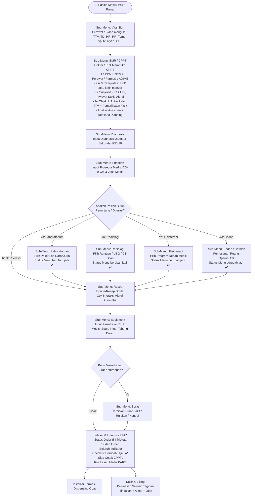

# DOKUMENTASI STANDAR MENU & ALUR KERJA REKAM MEDIS ELEKTRONIK (EMR / CPPT)
**Catatan Perkembangan Pasien Terintegrasi (CPPT) — SIMRS-ASOY**

Dokumen ini mendefinisikan secara menyeluruh struktur 11 sub-menu klinis, pembagian peran Profesional Pemberi Asuhan (PPA), dan alur kerja terintegrasi (*end-to-end clinical workflow*) pada modul Rekam Medis Elektronik (RME / EMR) berbasis standar akreditasi KARS/JCI.

---

## 1. Konsep & Filosofi CPPT Terintegrasi

Catatan Perkembangan Pasien Terintegrasi (CPPT) adalah lembar kerja klinis sentral tempat seluruh tenaga medis yang merawat pasien mendokumentasikan asuhan secara kolaboratif:
- **Dokter (DPJP & Dokter Jaga)**: Format **SOAP** (Subjektif, Objektif, Asesmen, Planning).
- **Perawat & Bidan**: Format **SOAP / SBAR** (Situation, Background, Assessment, Recommendation) untuk catatan harian & timbang terima (*handover*).
- **Farmasi Klinis**: Format **SOAP / Rekonsiliasi Obat** (Analisis DRP - *Drug Related Problems*, interaksi obat, dan kepatuhan).
- **Tenaga Gizi (Dietisien)**: Format **ADIME** (Assessment, Diagnosis Gizi, Intervensi Gizi, Monitoring, Evaluasi).
- **Fisioterapis & Rehabilitasi Medik**: Format **SOAP / ICF** (Fungsional gerak, mobilitas, dan target fisioterapi).

---

## 2. Struktur Navigasi 11 Sub-Menu Klinis EMR

Navigasi internal EMR menggunakan panel vertikal sisi kiri dengan indikator visual status penyelesaian:
- **Status Belum Lengkap / Belum Ada Order**: Ikon lingkaran merah `(❌)`
- **Status Lengkap / Terisi / Sudah Order**: Ikon lingkaran hijau `(✔️)`

```
+---------------------------------------------------------------------------------------+
| STATUS ATAS: [Belum Order / Sudah Order]  |  • Alergi: [Tidak Ada / Ibuprofen, Debu]  |
+---------------------------------------------------------------------------------------+
| 1. [🟠] Vital Sign        (❌/✔️) -> TTV (TD, HR, Suhu, RR, SpO2, BB, TB, Nyeri, GCS) |
| 2. [🟣] Diagnosis         (❌/✔️) -> ICD-10 Primer, Sekunder, dan Catatan Klinis     |
| 3. [🟡] Tindakan          (❌/✔️) -> ICD-9-CM Prosedur Medis, Bedah Kecil, Jasa Medis|
| 4. [🔴] Laboratorium      (❌/✔️) -> Order Pemeriksaan Patologi Darah / Urin / Kimia |
| 5. [🔵] Fisioterapi       (❌/✔️) -> Order Terapi Fisik, Rehabilitasi & Target Gerak |
| 6. [🔷] Radiologi         (❌/✔️) -> Order Rontgen, USG, CT-Scan, MRI                 |
| 7. [🌸] Bedah / Cathlab   (❌/✔️) -> Penjadwalan OK / Bedah & Pra-Anestesi           |
| 8. [🟢] Resep             (❌/✔️) -> e-Resep Obat Jadi, Racikan, Dosis & Aturan Minum|
| 9. [🔴] EMR (CPPT Aktif)  (✔️)    -> Lembar Asesmen SOAP / SBAR / ADIME Terpadu      |
| 10.[🟣] Surat             (❌/✔️) -> Surat Sakit, Sehat, Rujukan, Pengantar Rawat Inap|
| 11.[🔘] Equipment         (❌/✔️) -> BHP Medis, Spuit, Infus, Pemakaian Alat Medis   |
+---------------------------------------------------------------------------------------+
| INFORMASI BAWAH:                                                                      |
| • Status Pasien: BARU / LAMA          • Tgl Pulang: -                                 |
| • Lama Rawat: 1 Hari                  • Status Pulang: - (Sembuh / Rujuk / APS)       |
+---------------------------------------------------------------------------------------+
```

---

## 3. Rincian Fungsi 11 Sub-Menu Klinis

| No | Nama Menu | Kode Ikon & Warna | Fungsi Utama & Data yang Diinput | Integrasi Antar-Modul |
| :---: | :--- | :--- | :--- | :--- |
| **1** | **Vital Sign** | Orange (`bg-amber-500`) | Input Tanda-Tanda Vital: Tekanan Darah (Sistol/Diastol), Heart Rate (bpm), Laju Napas (RR), Suhu (°C), Saturasi O2 (%), Berat Badan (kg), Tinggi Badan (cm), Skala Nyeri (0–10), dan Skor GCS. | Mengalir otomatis ke kolom **Objektif (O)** pada form SOAP EMR dan riwayat grafik keperawatan. |
| **2** | **Diagnosis** | Ungu Tua (`bg-purple-600`) | Input Diagnosis Medis Utama (*Primary*) dan Diagnosis Sekunder (*Comorbidity*) berbasis katalog **ICD-10**. | Data diagnosa digunakan untuk klaim BPJS Kesehatan (Ina-CBGs) dan riwayat rekam medis permanen. |
| **3** | **Tindakan** | Kuning Emas (`bg-yellow-500`) | Pencatatan tindakan klinis / prosedur medis berbasis **ICD-9-CM**, tindakan keperawatan, dan nebulisasi/injeksi. | Otomatis membukukan tarif jasa medis & BHP tindakan ke modul **Kasir & Billing**. |
| **4** | **Laboratorium** | Merah Muda (`bg-rose-500`) | Pemesanan (*order*) pemeriksaan lab: Darah Lengkap, Kimia Darah (SGOT, SGPT, Ureum, Kreatinin), Gula Darah, Urin Rutin, Serologi. | Mengirim order elektronik ke antrean modul **Support (Laboratorium)**. Hasil terbit otomatis muncul di timeline EMR. |
| **5** | **Fisioterapi** | Cyan Muda (`bg-cyan-500`) | Permintaan rehabilitasi medis, latihan gerak pasif/aktif, *chest physiotherapy*, terapi inhalasi, atau terapi tumbuh kembang anak. | Mengirimkan surat rujukan internal ke terapis / poli rehabilitasi medik. |
| **6** | **Radiologi** | Biru Kobalt (`bg-blue-600`) | Permintaan pemeriksaan radiodiagnostik: Rontgen Thorax AP/PA, Rontgen Extremitas, USG Abdomen, CT-Scan, dan MRI. | Mengirim order ke instalasi **Radiologi**. File ekspertise radiologi otomatis tersimpan di riwayat penunjang. |
| **7** | **Bedah / Cathlab** | Salmon Peach (`bg-pink-400`) | Pendaftaran & pemesanan kamar operasi (OK) untuk operasi elektif/cito, tindakan kateterisasi jantung (Cathlab), dan pra-anestesi. | Membuka jadwal penjadwalan kamar bedah dan mengunci tim operator dokter spesialis bedah & anestesi. |
| **8** | **Resep** | Hijau Toska (`bg-teal-500`) | Pembuatan e-Resep dokter untuk obat paten/generik non-racikan maupun racikan (pulveres/kapsul/sirup), signa, aturan minum, dan jumlah. | Terkoneksi real-time ke modul **Instalasi Farmasi** untuk proses telaah resep, stok FEFO depo, dan dispensing obat. |
| **9** | **EMR (CPPT)** | Magenta Ruby (`bg-fuchsia-600`) | Lembar kerja utama SOAP / SBAR / ADIME. Dilengkapi tombol *+ Template CPPT*, tombol pembanding riwayat, serta PPA Role switcher. | Disimpan dengan tanda tangan digital tenaga medis bersangkutan dan dikunci (*lock*) setelah diverifikasi DPJP. |
| **10**| **Surat** | Violet Gelap (`bg-indigo-600`) | Penerbitan dokumen resmi: Surat Keterangan Sakit, Surat Keterangan Sehat, Surat Rujukan FKRTL, Surat Kontrol Rawat Jalan, atau Resume Pulang. | Terbit dengan nomor surat otomatis dan QR-Code validasi keabsahan dokumen medis. |
| **11**| **Equipment** | Abu Slate (`bg-slate-600`) | Pencatatan pemakaian Bahan Medis Habis Pakai (BMHP) & alat kesehatan: spuit, wing needle, infus set, abocath, kateter, monitor pasien, oksigen. | Otomatis mengurangi stok fisik di gudang/depo farmasi (**Logistik**) dan memasukkan biaya ke **Kasir/Billing**. |

---

## 4. Diagram Alur Kerja Klinis End-to-End (Clinical Workflow)



---

## 5. Fitur Kolaborasi Antar-PPA (Header Switches & Timeline Filter)

### 5.1 Switch Mode Format Pengisian (PPA Toggles)
Di bagian atas form input CPPT, tersedia sakelar cepat (*toggle*) untuk mengubah struktur form sesuai disiplin profesi:
1. **DOKTER**: Format 4 Bagian (S - O - A - P) terikat ICD-10 dan ICD-9.
2. **PERAWAT**: Format SOAP Keperawatan dengan Standar Diagnosa Keperawatan Indonesia (SDKI / SIKI / SLKI).
3. **FARMASI KLINIS**: Format Telaah Resep & Rekonsiliasi Obat (Analisis interaksi obat dan alergi).
4. **ADIME (GIZI)**: Format Asuhan Gizi:
   - **A** (Assessment Gizi & Antropometri)
   - **D** (Diagnosis Gizi klinis/intake)
   - **I** (Intervensi Gizi & Menu Diet)
   - **M-E** (Monitoring & Evaluasi Asupan)
5. **SBAR**: Format Komunikasi Efektif & Timbang Terima (*Handover*):
   - **S** (Situation): Kondisi akut saat ini.
   - **B** (Background): Latar belakang riwayat medis penting.
   - **A** (Assessment): Kesimpulan evaluasi klinis saat ini.
   - **R** (Recommendation): Saran tindakan darurat / pemantauan ketat.
6. **RIWAYAT SEBELUMNYA**: Sakelar aktif untuk menampilkan catatan sesi sebelumnya berdampingan (*side-by-side comparison*) tanpa menutup form yang sedang diedit.

### 5.2 Filter Panel Riwayat CPPT (Sisi Kanan)
Panel kanan menyajikan riwayat perjalanan klinis pasien (*Integrated Patient Journey*) dengan opsi filter:
- **Filter Jenis PPA**: Menampilkan hanya catatan dokter, perawat, atau gizi.
- **Filter By Tenaga Medis**: Menemukan catatan yang dibuat oleh dokter/spesialis tertentu.
- **Filter By Ruangan**: Memilih riwayat saat pasien di IGD, Ruang Operasi, ICU, atau Rawat Inap.
- **Tombol Clear Filter**: Mereset filter kembali ke seluruh riwayat kronologis.

---

## 6. Validasi Keselamatan Klinis & Aturan Bisnis

1. **Safety Warning Alergi**: Kotak status di atas menu kiri menampilkan badge merah tebal jika pasien memiliki alergi obat (contoh: *Ibuprofen*, *Penicillin*). Saat meresepkan obat golongan tersebut, sistem memberikan peringatan konfirmasi *Drug-Allergy Interaction*.
2. **Medical Record Locking**: Setelah status diverifikasi (*Finalize*), catatan SOAP terkunci permanen (*tamper-proof*) dan tidak dapat dimodifikasi tanpa mekanisme *Addendum* resmi berizin khusus untuk kepatuhan hukum dan jejak audit Permenkes 24/2022.
3. **Sinkronisasi Tagihan Kasir Otomatis**: Setiap item tindakan (Menu 3), pemeriksaan lab (Menu 4), radiologi (Menu 6), resep obat (Menu 8), dan alat habis pakai (Menu 11) secara otomatis mengalir ke akun kasir pasien (`Billing ID`) tanpa perlu entri manual ganda.
